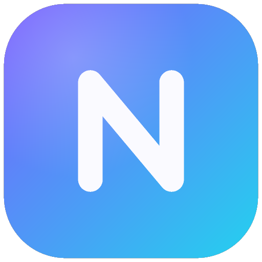

# Nebula VPN

Десктопный VPN-клиент для Windows в духе Happ: тёмный интерфейс, подписки, список серверов, пинг, живой график скорости и **разделение трафика** — через VPN идут только нужные приложения, сайты или весь трафик.

Внутри — [sing-box](https://sing-box.sagernet.org/) с нативным TUN-адаптером (Wintun), поэтому VPN работает на уровне системы, а не только в браузере.



## Возможности

- **TUN / полный VPN** — весь трафик приложения и системы идёт через туннель.
- **Разделение трафика**
  - «Весь трафик» — через VPN всё, кроме российских сайтов и локальной сети.
  - «Только выбранные» — VPN используют только указанные `.exe`.
  - «Всё, кроме выбранных» — выбранные приложения идут напрямую.
  - Свои домены: «всегда через VPN» и «всегда напрямую».
  - Российские сайты и IP напрямую (geosite-category-ru + geoip-ru).
  - Блокировка рекламы (geosite-category-ads-all).
- **Подписки** — ссылка на подписку, автоматическое обновление, импорт вручную.
- **Протоколы** — VLESS (включая REALITY), VMess, Trojan, Shadowsocks, Hysteria2, TUIC, AnyTLS, SOCKS/HTTP.
- **Живая статистика** — скорость и общий трафик через Clash API.
- **Пинг** — TCP-задержка до сервера, а при подключении — реальная задержка через прокси.
- **Трей**, автозапуск, запуск свёрнутым, журнал ядра.
- **Права администратора** запрашиваются только при подключении (UAC).

## Требования

- Windows 10/11 x64.
- Node.js 20+ и npm (для запуска из исходников).
- Права администратора для TUN-режима — это требование Windows к созданию виртуального адаптера.

## Запуск

```powershell
npm install
npm start
```

При первом подключении Windows покажет UAC-запрос — приложение перезапустится с правами администратора и сразу подключится к выбранному серверу.

## Как пользоваться

1. Откройте **Подписки** и вставьте ссылку на подписку (или добавьте отдельную ссылку в **Серверы → Добавить ссылку**).
2. Выберите сервер на странице **Серверы**, при желании нажмите «Проверить пинг».
3. Перейдите на **Главную** и нажмите «Подключить». Подтвердите UAC.
4. Настройте **Маршрутизацию**: режим разделения, приложения и домены.

### Разделение трафика

Правила применяются в таком порядке:

1. Домены из «Всегда через VPN».
2. Блокировка рекламы (если включена).
3. Домены из «Всегда напрямую».
4. Локальная сеть (`ip_is_private`).
5. Российские домены и IP (`geosite-category-ru`, `geoip-ru`).
6. Приложения из списка (режимы «Только выбранные» / «Всё, кроме выбранных»).
7. Всё остальное — согласно выбранному режиму.

Список приложений задаётся именами процессов (`chrome.exe`, `Telegram.exe`). Кнопка «Добавить .exe» берёт имя из выбранного файла.

Изменения маршрутизации применяются автоматически: клиент переподключается.

## Сборка установщика

```powershell
npm install
npm run dist
```

Готовый установщик появится в `dist\NebulaVPN-1.0.0-setup.exe`. Ядро и правила упаковываются в `resources\core`. Установщик не подписан — при первом запуске Windows SmartScreen может показать предупреждение.

## Обновление ядра и правил

```powershell
npm run core:fetch
```

Скрипт скачает последний sing-box для Windows, обновит `core/rules/*.srs` и проверит наличие `wintun.dll`.

> `wintun.dll` не входит в релизы sing-box. В этом проекте используется подписанная версия 0.14.1 (WireGuard LLC). При распространении приложения учитывайте лицензию Wintun (GPLv2) и при необходимости предложите пользователю скачать DLL самостоятельно с <https://www.wintun.net/>.

## Тесты

```powershell
npm test
```

- `tests/run.mjs` — разбор всех поддерживаемых ссылок, base64/JSON-подписок и проверка сгенерированных конфигов через `sing-box check`.
- `tests/runtime.mjs` — реальный запуск ядра, HTTP-прокси и Clash API (пинг/статистика).

## Структура

```
main.js                 главный процесс Electron, IPC, трей, подключение
preload.js              безопасный мост renderer ↔ main
src/index.html          интерфейс
src/styles.css          стили
src/app.js              логика интерфейса
src/lib/parsers.js      разбор vless/vmess/trojan/ss/hysteria2/tuic/anytls
src/lib/config.js       генерация конфигурации sing-box и правил маршрутизации
src/lib/core.js         запуск ядра, логи, Clash API, статистика, пинг
src/lib/win.js          проверка прав, UAC-перезапуск, автозапуск
src/lib/store.js        состояние в %APPDATA%\NebulaVPN\state.json
core/                   sing-box.exe, wintun.dll, локальные наборы правил
scripts/                загрузка ядра, генерация иконок, демо-данные
tests/                  тесты
```

## Ограничения

- Только Windows (используется Wintun и реестр Windows).
- Нет kill switch и собственного автообновления приложения.
- Нет импорта QR-кодов и формата Clash YAML.
- При аварийном завершении приложения адаптер Wintun может остаться в системе до перезагрузки.

## Правовая заметка

Приложение — клиент. Оно не предоставляет серверы и не обходит ограничения само по себе. Используйте только те серверы и подписки, которые вам разрешены, и соблюдайте законодательство вашей страны.
